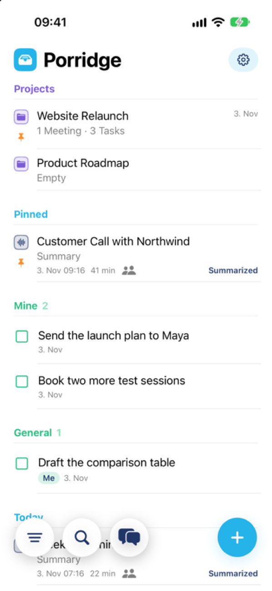
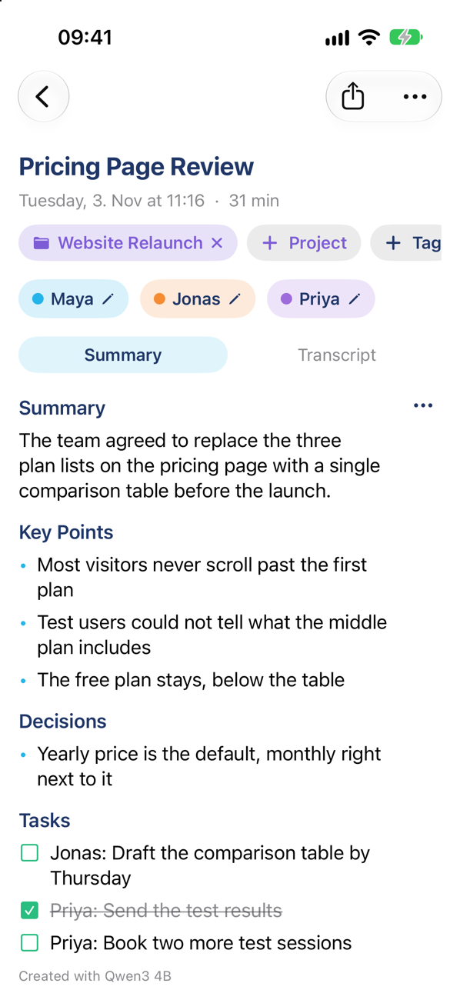
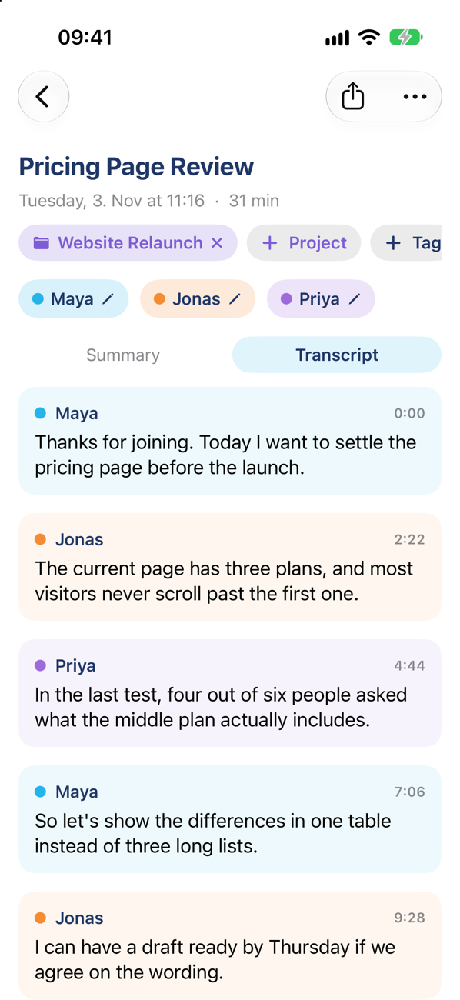
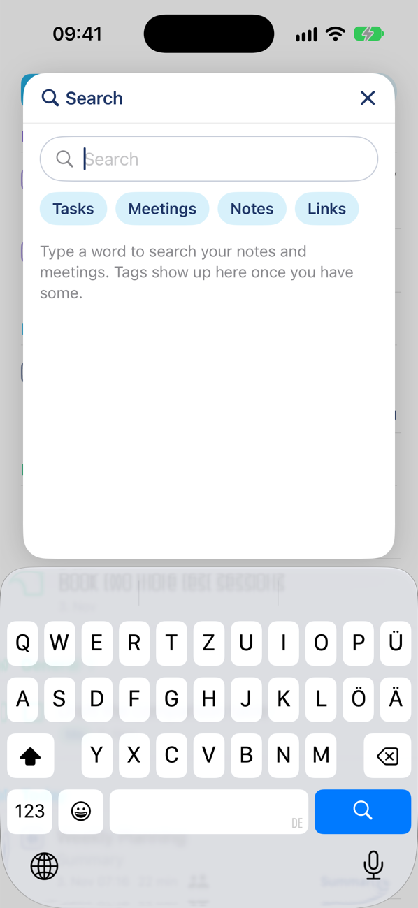
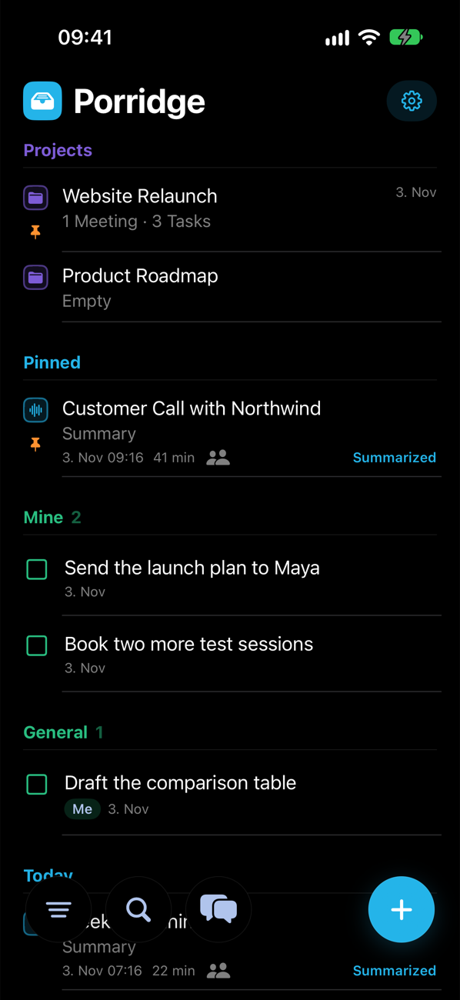
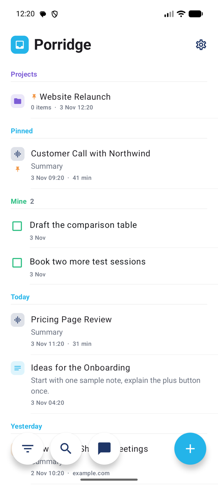

<p align="center">
  
</p>

<h1 align="center">Porridge</h1>

<p align="center">
  <strong>Notes, meetings and dictation, transcribed on your device.</strong><br>
  For iPhone, iPad, Mac and Android.
</p>

<p align="center">
  <a href="https://testflight.apple.com/join/n4TkBTJA"></a>
  <a href="https://github.com/1letzgo/porridge/releases?q=android-v"></a>
</p>

<p align="center">
  
  
  
</p>

Porridge records what is said in a meeting, writes it down with speaker names and turns it into a summary with tasks. Speech recognition runs on your device and summaries can too, so a recording does not have to leave it. Notes, saved links and projects live in one quiet list.

## What it does

- **Meetings:** Record a meeting and get a transcript with speakers. Porridge recognizes voices it has learned. A two-channel microphone assigns each channel to one person.
- **Summaries with templates:** Choose General, One-on-One, Customer Call, Lecture or your own template each time. Tasks stay in the summary, where you can tick them off.
- **Your choice of model:** On-device models and cloud models with your own key sit in one list. Pick a default, and switch for a single meeting when you summarize it.
- **Dictation:** Dictate into any note. On the Mac, a global shortcut types into whatever app you are using.
- **Notes:** Headings, lists and checklists as you type, stored as Markdown.
- **Links:** Share a page to Porridge to save its text and summarize it.
- **Projects:** Keep notes, meetings and links together, with pinned projects at the top.
- **Search:** Search notes, transcripts, summaries and saved pages, narrowed by kind or tag.
- **Sync:** iCloud on Apple devices, or your own Nextcloud across all platforms. With Nextcloud, recordings upload on Wi-Fi and download when you ask for them. With iCloud they stay on the device that made them.
- **Plaud import without the cloud:** Copy recordings straight from a Plaud recorder over Bluetooth, so they do not have to go through Plaud's cloud. You sign in to Plaud once in Settings to connect the recorder, then import from the plus button; the transcript and summary then come from Porridge.

<p align="center">
  
  
  
</p>

## On your device

| | Runs locally | Optional |
| --- | --- | --- |
| **Speech** | Parakeet TDT v3 (25 European languages), Apple Speech on Apple devices | |
| **Speakers** | pyannote | |
| **Summaries** | Nemotron 3.5 Bolt, Qwen3 4B or Qwen3 1.7B, recommended to suit your device; Apple Intelligence on Apple devices | Your own key for OpenRouter, OpenAI, Anthropic, Google, Mistral, Groq or a compatible server |

Models download once and then work offline. With iCloud, audio stays on the device that recorded it; with Nextcloud, recordings sync too.

## Get it

| Platform | How | Needs |
| --- | --- | --- |
| **Mac** | [Join the TestFlight beta](https://testflight.apple.com/join/n4TkBTJA). | macOS 15 |
| **Android** | [Latest APK](https://github.com/1letzgo/porridge/releases?q=android-v). Later versions come through the in-app update. | Android 8 |
| **iPhone and iPad** | [Join the TestFlight beta](https://testflight.apple.com/join/n4TkBTJA). | iOS 18 |

## Build from source

```sh
brew install xcodegen
xcodegen generate
open Porridge.xcodeproj
```

Use the `Porridge` scheme for iPhone and iPad and `PorridgeMac` for the Mac. You need your own Apple team and iCloud container for signing. For Android, see [android/README.md](android/README.md).

## Project layout

| Path | Content |
| --- | --- |
| `Porridge/Models` | SwiftData models |
| `Porridge/Services` | Recording, transcription, summaries, search, sync, Plaud |
| `Porridge/Views`, `Porridge/Design` | SwiftUI views and the shared look |
| `PorridgeMac` | Mac app: dictation shortcut, menu bar, updates |
| `PorridgeWidgets`, `PorridgeShare` | Widgets, Live Activity and the share extension |
| `android` | Native Android app in Kotlin and Compose |
| `scripts` | Release scripts for Mac, Android and TestFlight |

The look and its rules are written down in [DESIGN.md](DESIGN.md).

## Acknowledgements

Porridge stands on the work of these projects. Thank you! The full license texts are in the app under Settings → Acknowledgements.

### iPhone, iPad and Mac

<details>
<summary>Libraries</summary>

| Project | Version | License |
| --- | --- | --- |
| [EventSource](https://github.com/mattt/EventSource) | 1.5.1 | MIT |
| [fastcluster (in FluidAudio)](https://danifold.net/fastcluster.html) | – | BSD 2-Clause |
| [FluidAudio](https://github.com/FluidInference/FluidAudio) | c9cad1b | Apache 2.0 |
| [{fmt} (in MLX Swift)](https://github.com/fmtlib/fmt) | 12.1.0 | MIT |
| [JSON for Modern C++ (in MLX Swift)](https://github.com/nlohmann/json) | 3.11.3 | MIT |
| [Metal C++ (in MLX Swift)](https://developer.apple.com/metal/cpp/) | macOS 15 / iOS 18 | Apache 2.0 |
| [MLX (in MLX Swift)](https://github.com/ml-explore/mlx) | 0.32.2 | MIT |
| [MLX C (in MLX Swift)](https://github.com/ml-explore/mlx-c) | 0.6.0 | MIT |
| [MLX Swift](https://github.com/ml-explore/mlx-swift) | 0.32.3 | MIT |
| [MLX Swift LM](https://github.com/ml-explore/mlx-swift-lm) | 3.32.3 | MIT |
| [NeMo Text Processing (in FluidAudio)](https://github.com/FluidInference/text-processing-rs) | 0.3.0 | Apache 2.0 |
| [plaude-archiver (Plaud Bluetooth protocol)](https://github.com/roopen219/plaude-archiver) | – | MIT |
| [Swift ASN.1](https://github.com/apple/swift-asn1) | 1.7.3 | Apache 2.0 |
| [Swift Collections](https://github.com/apple/swift-collections) | 1.7.5 | Apache 2.0 |
| [Swift Crypto](https://github.com/apple/swift-crypto) | 4.5.2 | Apache 2.0 |
| [Swift Hugging Face](https://github.com/huggingface/swift-huggingface) | 0.13.0 | Apache 2.0 |
| [Swift Jinja](https://github.com/huggingface/swift-jinja) | 2.5.2 | Apache 2.0 |
| [Swift Numerics](https://github.com/apple/swift-numerics) | 1.1.1 | Apache 2.0 |
| [Swift Syntax](https://github.com/swiftlang/swift-syntax) | 603.0.2 | Apache 2.0 |
| [Swift Transformers](https://github.com/huggingface/swift-transformers) | 1.3.5 | Apache 2.0 |
| [VBx (in FluidAudio)](https://github.com/BUTSpeechFIT/VBx) | – | Apache 2.0 |
| [yyjson](https://github.com/ibireme/yyjson) | 0.12.0 | MIT |

</details>

<details>
<summary>Models</summary>

| Project | Version | License |
| --- | --- | --- |
| [Nemotron 3.5 Bolt-E4B (MLX, 4-bit)](https://huggingface.co/lmstudio-community/NVIDIA-Nemotron-3.5-Bolt-E4B-MLX-4bit) | E4B | OpenMDW 1.1 |
| [Parakeet TDT v3 (Core ML)](https://huggingface.co/FluidInference/parakeet-tdt-0.6b-v3-coreml) | 0.6B | CC BY 4.0 |
| [Qwen3 1.7B (MLX, 4-bit)](https://huggingface.co/mlx-community/Qwen3-1.7B-4bit) | 1.7B | Apache 2.0 |
| [Qwen3 4B Instruct 2507 (MLX, 4-bit)](https://huggingface.co/mlx-community/Qwen3-4B-Instruct-2507-4bit) | 4B | Apache 2.0 |
| [Qwen3.5 4B (MLX, 4-bit)](https://huggingface.co/mlx-community/Qwen3.5-4B-MLX-4bit) | 4B | Apache 2.0 |
| [Speaker Diarization Community-1 (Core ML)](https://huggingface.co/FluidInference/speaker-diarization-coreml) | – | CC BY 4.0 |

</details>

### Android

<details>
<summary>Libraries</summary>

| Project | Version | License |
| --- | --- | --- |
| [AndroidX Activity](https://developer.android.com/jetpack/androidx/releases/activity) | 1.9.3 | Apache 2.0 |
| [AndroidX AppCompat](https://developer.android.com/jetpack/androidx/releases/appcompat) | 1.7.0 | Apache 2.0 |
| [AndroidX Core](https://developer.android.com/jetpack/androidx/releases/core) | 1.15.0 | Apache 2.0 |
| [AndroidX Lifecycle](https://developer.android.com/jetpack/androidx/releases/lifecycle) | 2.8.7 | Apache 2.0 |
| [AndroidX Room](https://developer.android.com/jetpack/androidx/releases/room) | 2.6.1 | Apache 2.0 |
| [AndroidX Security Crypto](https://developer.android.com/jetpack/androidx/releases/security) | 1.1.0-alpha06 | Apache 2.0 |
| [AndroidX SQLite](https://developer.android.com/jetpack/androidx/releases/sqlite) | 2.4.0 | Apache 2.0 |
| [AndroidX WorkManager](https://developer.android.com/jetpack/androidx/releases/work) | 2.10.0 | Apache 2.0 |
| [Compose Material 3](https://developer.android.com/jetpack/androidx/releases/compose-material3) | 1.3.1 | Apache 2.0 |
| [Compose Material Icons](https://developer.android.com/jetpack/androidx/releases/compose-material) | 1.7.6 | Apache 2.0 |
| [desugar_jdk_libs](https://github.com/google/desugar_jdk_libs) | 2.1.5 | GPL 2.0 with Classpath Exception |
| [Gson](https://github.com/google/gson) | 2.8.9 | Apache 2.0 |
| [Guava ListenableFuture](https://github.com/google/guava) | 1.0 | Apache 2.0 |
| [JetBrains Java Annotations](https://github.com/JetBrains/java-annotations) | 23.0.0 | Apache 2.0 |
| [Jetpack Compose (UI, Foundation, Animation)](https://developer.android.com/jetpack/androidx/releases/compose) | 1.7.6 | Apache 2.0 |
| [Kotlin Standard Library](https://github.com/JetBrains/kotlin) | 2.2.21 | Apache 2.0 |
| [kotlinx.coroutines](https://github.com/Kotlin/kotlinx.coroutines) | 1.9.0 | Apache 2.0 |
| [kotlinx.serialization](https://github.com/Kotlin/kotlinx.serialization) | 1.7.3 | Apache 2.0 |
| [llama-android](https://github.com/ffmpegkit-maintained/llama-android) | 0.1.1 | MIT |
| [llama.cpp (in llama-android)](https://github.com/ggml-org/llama.cpp) | – | MIT |
| [OkHttp](https://github.com/square/okhttp) | 5.3.2 | Apache 2.0 |
| [Okio](https://github.com/square/okio) | 3.16.4 | Apache 2.0 |
| [ONNX Runtime (in sherpa-onnx)](https://github.com/microsoft/onnxruntime) | – | MIT |
| [Other AndroidX libraries (Annotation, Collection, SavedState, Startup, …)](https://developer.android.com/jetpack/androidx) | – | Apache 2.0 |
| [plaude-archiver (Plaud Bluetooth protocol)](https://github.com/roopen219/plaude-archiver) | – | MIT |
| [sherpa-onnx](https://github.com/k2-fsa/sherpa-onnx) | 2.0.1 | Apache 2.0 |
| [Tink](https://github.com/tink-crypto/tink-java) | 1.8.0 | Apache 2.0 |

</details>

<details>
<summary>Models</summary>

| Project | Version | License |
| --- | --- | --- |
| [Parakeet TDT v3 (ONNX, int8)](https://huggingface.co/csukuangfj/sherpa-onnx-nemo-parakeet-tdt-0.6b-v3-int8) | 0.6B | CC BY 4.0 |
| [pyannote Segmentation 3.0 (ONNX)](https://huggingface.co/pyannote/segmentation-3.0) | 3.0 | MIT |
| [Nemotron 3.5 Bolt-E4B (GGUF)](https://huggingface.co/unsloth/NVIDIA-Nemotron-3.5-Bolt-E4B-GGUF) | E4B | OpenMDW 1.1 |
| [Qwen3 1.7B (GGUF)](https://huggingface.co/Qwen/Qwen3-1.7B-GGUF) | 1.7B | Apache 2.0 |
| [Qwen3 4B Instruct 2507 (GGUF)](https://huggingface.co/unsloth/Qwen3-4B-Instruct-2507-GGUF) | 4B | Apache 2.0 |
| [Qwen3.5 4B (GGUF)](https://huggingface.co/unsloth/Qwen3.5-4B-GGUF) | 4B | Apache 2.0 |
| [WeSpeaker CAM++ VoxCeleb (ONNX)](https://github.com/wenet-e2e/wespeaker) | – | CC BY 4.0 |

</details>
