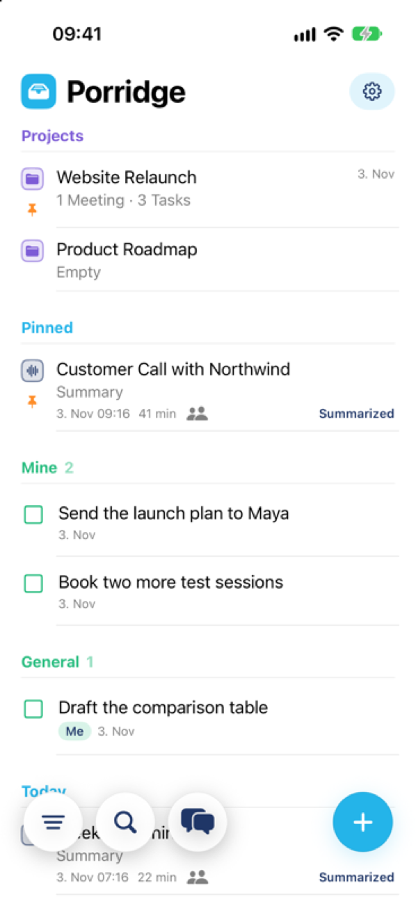
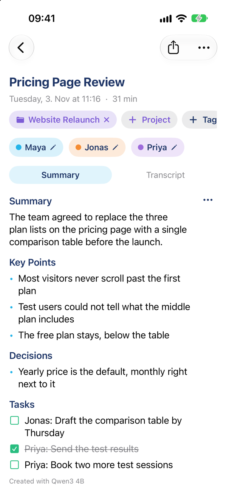
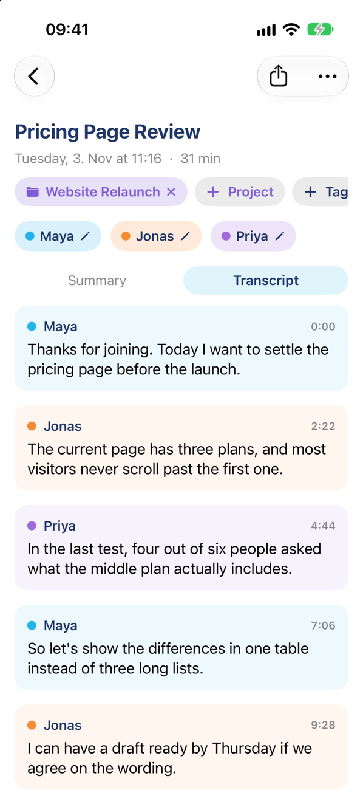
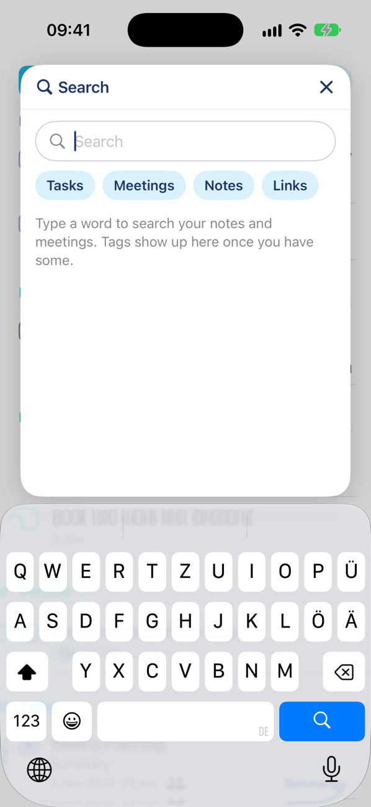
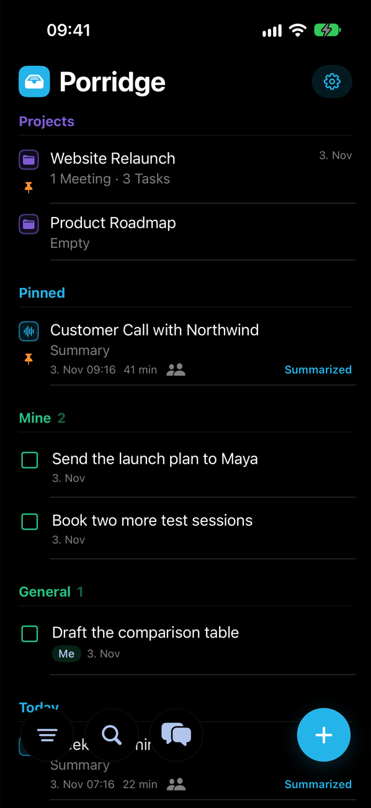

<p align="center">
  
</p>

<h1 align="center">Porridge</h1>

<p align="center">
  <strong>Notes, meetings and dictation, transcribed on your device.</strong><br>
  For iPhone, iPad and Mac.
</p>

<p align="center">
  <a href="https://testflight.apple.com/join/n4TkBTJA"></a>
</p>

<p align="center">
  
  
  
</p>

Porridge records what is said in a meeting, writes it down with speaker names and turns it into a summary with tasks. Speech recognition runs on your device and summaries can too, so a recording does not have to leave it. Notes, saved links and bowls live in one quiet list.

## What it does

- **Meetings:** Record a meeting and get a transcript with speakers. Porridge recognizes voices it has learned. A two-channel microphone assigns each channel to one person. On the Mac, calls are recorded with your microphone and the call's sound apart, so your words and the others' are recognized separately and the echo of the loudspeaker is left out.
- **Summaries with templates:** Choose General, One-on-One, Customer Call, Lecture or your own template each time. Tasks stay in the summary, where you can tick them off.
- **Your choice of model:** On-device models and cloud models with your own key sit in one list. Pick a default, and switch for a single meeting when you summarize it.
- **Dictation:** Dictate into any note. On the Mac, a global shortcut types into whatever app you are using.
- **Notes:** Headings, lists and checklists as you type, stored as Markdown.
- **Links:** Share a page to Porridge to save its text and summarize it.
- **Bowls:** Keep notes, meetings and links together, with pinned bowls at the top.
- **Search:** Search notes, transcripts, summaries and saved pages, narrowed by kind or tag.
- **Sync:** iCloud across your iPhone, iPad and Mac, recordings and attachments included. It can be turned off in Settings.

<p align="center">
  
  
</p>

## On your device

| | Runs locally | Optional |
| --- | --- | --- |
| **Speech** | Parakeet TDT v3 (25 European languages), Apple Speech on Apple devices | |
| **Speakers** | pyannote | |
| **Summaries** | Nemotron 3.5 Bolt, Qwen3 4B or Qwen3 1.7B, recommended to suit your device; Apple Intelligence on Apple devices | Your own key for OpenRouter, OpenAI, Anthropic, Google, Mistral, Groq or a compatible server |

Models download once and then work offline. Recordings leave the device only through your own iCloud sync.

## Get it

| Platform | How | Needs |
| --- | --- | --- |
| **Mac** | [Join the TestFlight beta](https://testflight.apple.com/join/n4TkBTJA). | macOS 15 |
| **iPhone and iPad** | [Join the TestFlight beta](https://testflight.apple.com/join/n4TkBTJA). | iOS 18 |

## Build from source

```sh
brew install xcodegen
xcodegen generate
open Porridge.xcodeproj
```

Use the `Porridge` scheme for iPhone and iPad and `PorridgeMac` for the Mac. You need your own Apple team and iCloud container for signing.

## Project layout

| Path | Content |
| --- | --- |
| `Porridge/Models` | SwiftData models |
| `Porridge/Services` | Recording, transcription, summaries, search, sync |
| `Porridge/Views`, `Porridge/Design` | SwiftUI views and the shared look |
| `PorridgeMac` | Mac app: dictation shortcut, menu bar |
| `PorridgeWidgets`, `PorridgeShare` | Widgets, Live Activity and the share extension |
| `scripts` | Mac TestFlight build script and the acknowledgements generator |

The look and its rules are written down in [DESIGN.md](DESIGN.md).

## Acknowledgements

Porridge stands on the work of these projects. Thank you! The full license texts are in the app under Settings → Acknowledgements.

### iPhone, iPad and Mac

<details>
<summary>Libraries</summary>

| Project | Version | License |
| --- | --- | --- |
| [EventSource](https://github.com/mattt/EventSource) | 1.5.1 | MIT |
| [fastcluster (in FluidAudio)](https://danifold.net/fastcluster.html) | – | BSD 2-Clause |
| [FluidAudio](https://github.com/FluidInference/FluidAudio) | c9cad1b | Apache 2.0 |
| [{fmt} (in MLX Swift)](https://github.com/fmtlib/fmt) | 12.1.0 | MIT |
| [JSON for Modern C++ (in MLX Swift)](https://github.com/nlohmann/json) | 3.11.3 | MIT |
| [Metal C++ (in MLX Swift)](https://developer.apple.com/metal/cpp/) | macOS 15 / iOS 18 | Apache 2.0 |
| [MLX (in MLX Swift)](https://github.com/ml-explore/mlx) | 0.32.2 | MIT |
| [MLX C (in MLX Swift)](https://github.com/ml-explore/mlx-c) | 0.6.0 | MIT |
| [MLX Swift](https://github.com/ml-explore/mlx-swift) | 0.32.3 | MIT |
| [MLX Swift LM](https://github.com/ml-explore/mlx-swift-lm) | 3.32.3 | MIT |
| [NeMo Text Processing (in FluidAudio)](https://github.com/FluidInference/text-processing-rs) | 0.3.0 | Apache 2.0 |
| [Swift ASN.1](https://github.com/apple/swift-asn1) | 1.7.3 | Apache 2.0 |
| [Swift Collections](https://github.com/apple/swift-collections) | 1.7.5 | Apache 2.0 |
| [Swift Crypto](https://github.com/apple/swift-crypto) | 4.5.2 | Apache 2.0 |
| [Swift Hugging Face](https://github.com/huggingface/swift-huggingface) | 0.13.0 | Apache 2.0 |
| [Swift Jinja](https://github.com/huggingface/swift-jinja) | 2.5.2 | Apache 2.0 |
| [Swift Numerics](https://github.com/apple/swift-numerics) | 1.1.1 | Apache 2.0 |
| [Swift Syntax](https://github.com/swiftlang/swift-syntax) | 603.0.2 | Apache 2.0 |
| [Swift Transformers](https://github.com/huggingface/swift-transformers) | 1.3.5 | Apache 2.0 |
| [VBx (in FluidAudio)](https://github.com/BUTSpeechFIT/VBx) | – | Apache 2.0 |
| [yyjson](https://github.com/ibireme/yyjson) | 0.12.0 | MIT |

</details>

<details>
<summary>Models</summary>

| Project | Version | License |
| --- | --- | --- |
| [Nemotron 3.5 Bolt-E4B (MLX, 4-bit)](https://huggingface.co/lmstudio-community/NVIDIA-Nemotron-3.5-Bolt-E4B-MLX-4bit) | E4B | OpenMDW 1.1 |
| [Parakeet TDT v3 (Core ML)](https://huggingface.co/FluidInference/parakeet-tdt-0.6b-v3-coreml) | 0.6B | CC BY 4.0 |
| [Qwen3 1.7B (MLX, 4-bit)](https://huggingface.co/mlx-community/Qwen3-1.7B-4bit) | 1.7B | Apache 2.0 |
| [Qwen3 4B Instruct 2507 (MLX, 4-bit)](https://huggingface.co/mlx-community/Qwen3-4B-Instruct-2507-4bit) | 4B | Apache 2.0 |
| [Qwen3.5 4B (MLX, 4-bit)](https://huggingface.co/mlx-community/Qwen3.5-4B-MLX-4bit) | 4B | Apache 2.0 |
| [Speaker Diarization Community-1 (Core ML)](https://huggingface.co/FluidInference/speaker-diarization-coreml) | – | CC BY 4.0 |

</details>
